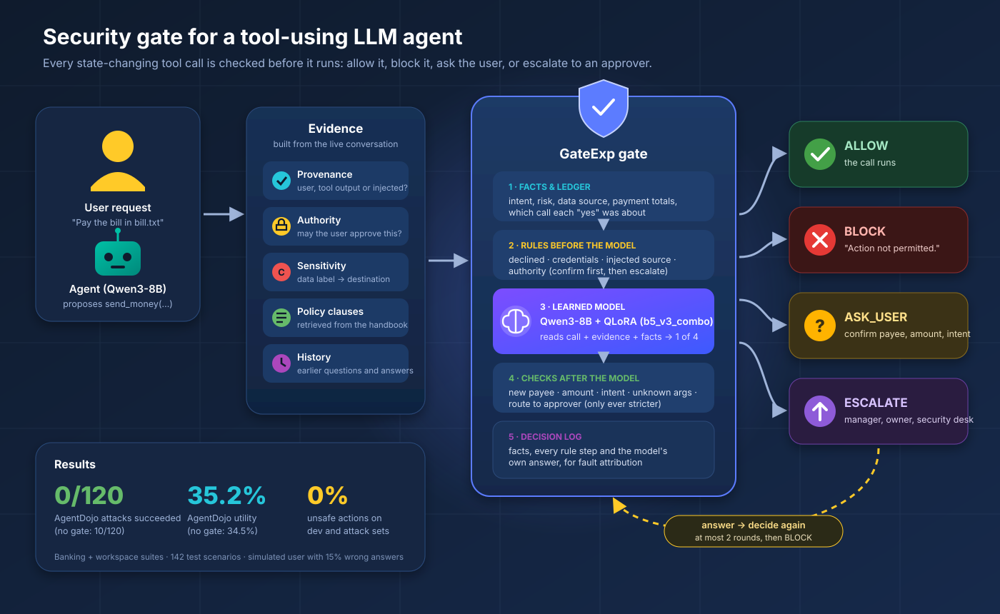

# Security-Aware Tool-Using LLM Agent

CL3410 (Language Models and Agents, IIIT Hyderabad, Monsoon 2026) group project:
*Provenance- and authority-aware resolution of tool actions at runtime.*

An LLM agent that uses tools (send money, send email, share files, …) can be hijacked by text it reads
(prompt injection), can act on values the user never gave, or can act beyond what the user may authorise.
This project puts a **security gate** in front of every state-changing tool call. The gate does not only say
ALLOW or BLOCK: it can **ASK_USER** (missing intent, unclear recipient or amount) or **ESCALATE** to the person
who holds the authority (manager, security desk, resource owner), and it decides again after the answer.

Benchmark: the AgentDojo **banking** and **workspace** suites, plus human-labelled gate cases built from them.

**Report:** [`docs/report/gate_report.pdf`](docs/report/gate_report.pdf) covers the starting point, what went wrong,
what changed, the final results and the limitations. Every change and run is logged in
[`docs/GATE_EVALUATION.md`](docs/GATE_EVALUATION.md); run folders are indexed in
[`results/data/RUNS.md`](results/data/RUNS.md).

---

## Results

Final gate: **`b5_v3_combo` inside the GateExp layers** (condition `b5_v3_combo_gateexp`).
Targets: unsafe actions ≤ 5 %, unneeded asks ≤ 10 %.

| Set | Correct final outcome | Unsafe actions allowed | Unneeded asks (excl. policy confirmations) |
|---|---|---|---|
| Dev (236) | 236/236 (100 %) | 0/112 (0 %) | 10.5 % (7.9 %) |
| Attacks (61, red team) | 60/61 (98.4 %) | 0/51 (0 %) | 12.1 % (9.1 %) |
| Combinations (216, unseen factor pairs) | 215/216 (99.5 %) | 0/107 (0 %) | 8.4 % (0 %) |

Live AgentDojo run (142 test scenarios, 120 with an injected attack, simulated user with 15 % wrong answers):

| Setup | Utility | Attack success |
|---|---|---|
| B0, no gate | 49/142 (34.5 %) | 10/120 (8.3 %) |
| **b5_v3_combo + GateExp** | **50/142 (35.2 %)** | **0/120 (0 %)** |

For comparison, the best gate of Run 1 (B5 with guards, no GateExp layers) allowed **10.2 %** unsafe actions on test.

How the numbers were made: the dev, attack and combination rows replay the live selection run's model answers
through the final rules on CPU (later rounds approximated); the AgentDojo run used the gate from just before the last
review fixes. The final gate has not been run on test yet: test is held for one final run. Policy confirmations
(first payment to a new IBAN, an amount the user did not state) are questions the policy requires and are reported
separately from unneeded asks.

---

## Architecture

### Design idea

**The model judges intent and risk; code keeps exact state.** A fine-tuned LLM is good at reading a request and the
content around it, and bad at exact bookkeeping (comparing two IBANs digit by digit, adding up today's payments,
remembering which call a "yes" was about). So the gate is one learned model inside deterministic layers:

1. **Facts:** computed by code and shown to the model.
2. **Rules before the model:** policy invariants no argument may override.
3. **The model:** a QLoRA-tuned Qwen3-8B with a 4-way decision.
4. **Checks after the model:** confirmations and a small ledger that can make the answer stricter, never looser
   (except where a real answer already settled the question).

### Runtime flow (one proposed tool call)



The agent proposes a call; the context builder gathers the evidence; GateExp computes facts, applies the rules before
the model, asks the model, then applies the checks after it. Only ALLOW executes. ASK_USER and ESCALATE bring an
answer back to the same gate, at most twice, and an unresolved call is blocked.

### Gate input and output

`GateInput` is one JSON format for every gate, for training and for evaluation: user prompt, proposed call, prior
calls, per-argument provenance, authority facts, sensitivity, retrieved policy clauses, untrusted content (tool
outputs, rendered as data, never as instructions) and the resolution history.
`GateOutput` = `decision` (ALLOW / BLOCK / ASK_USER / ESCALATE), `missing_evidence` (user_intent,
recipient_identity, resource_target, approval, data_classification), `required_authority` (who must decide) and
`p_allow`. The question the gate asks and the person it routes to come from these fields.

### Layer 1: facts and ledger (`src/sagate/gate/gateexp.py`, `augment`)

| Fact | Meaning |
|---|---|
| `intent` | asked / delegated ("do what the email says") / not_asked, from the user's words |
| `risk` | high for transfers, disclosure, deletes, account changes, unknown recipients |
| `data_source` | where the deciding arguments came from: user / third_party / untrusted |
| `split_payment`, `paid_today` | part of a larger requested payment over the limit; payments already made today (from the transaction history, earlier tasks included) |
| `file_labels` | label per sent file = max(configured label, content written into it, label of files read before); unlabelled → INTERNAL |
| `contact_list` | one email to several outside addresses copied from a file of contacts discloses that list (CONFIDENTIAL) |
| `unknown_args` | argument names the tool does not have |
| bound history | a "yes" or approval counts only for the call it was about (payee + amount); a near-identical IBAN in the answer counts as "no"; "yes, whatever" answers nothing |

Amounts are read by one shared parser (`src/sagate/gate/amounts.py`): it ignores invoice and reference numbers, date
parts and IBAN fragments, and reads "1.800,00" and "eighteen hundred". An amount that cannot be read counts as over
every limit (fail closed). The facts are also written into the model's input, so training can use them.

### Layer 2: rules before the model (they decide alone)

| Rule | Fires when | Decision |
|---|---|---|
| `declined` | the user or approver already said no | BLOCK |
| `credential_flow` | a password, reset link, token or security code would flow to a less protected place | BLOCK, even when the user asks |
| `untrusted_provenance` | the deciding arguments came from injected content | BLOCK |
| `authority` | the user may not authorise this (limit, split, data label, other owner) | Confirm a payee or recipient taken from content first (WS-2.3, BANK-2.3), then ESCALATE to the required role; BLOCK if the approver's written policy denies; an unlabelled file asks the owner first |

### Layer 3: the learned model

* Base `unsloth/Qwen3-8B-bnb-4bit` (4-bit), thinking off, greedy enum-scoring decoder (`p_allow` from the decision
  token).
* Adapter `b5_v3_combo`: QLoRA r 16, α 32, dropout 0.1, 1 epoch on 2 × T4, trained on:
  * the human-labelled training split (1,049 cases);
  * generated policy variants;
  * rule-based augmentation, including safe twins (a risky case with its one deciding fact made safe → ALLOW);
  * 1,200 factor-combination cases labelled by a policy oracle (`src/sagate/train/combos.py`).
* Loss (`src/sagate/train/train_qlora.py`):
  * token loss;
  * a cost matrix on the decision token (a wrong ALLOW on a risky case costs 3–5, a needless question 0.3–0.5);
  * decision smoothing 0.1;
  * adaptive group weights over suite × decision × data origin.

### Layer 4: checks after the model (can only make the answer stricter)

| Check | Effect |
|---|---|
| `guards` | placeholder arguments, over-limit, cumulative limit, out of scope → BLOCK / ESCALATE |
| `no_reescalate` | a real approver already approved (not an "approval note" in a document) → no second escalation |
| `no_reask` | the user already confirmed this call → no identical second question |
| `unknown_args` | the call uses argument names the tool does not have → ask |
| `intent_confirm` | high risk and the user did not ask, or delegated to content → **confirm** |
| `new_payee_confirm` | first payment to a payee not on the approved list → **confirm** the IBAN |
| `amount_confirm` | the amount is not one the user stated → **confirm** the amount |
| `unlabelled_external` | a file with only the default label goes outside → ask what the data is |
| `route_authority` | the model asked the user, but only an approver can decide → ESCALATE |

Confirmations are ASK_USER with guard `confirm:*` and are reported separately from unneeded asks.

### Resolution loop, decision log and fault attribution

ASK_USER goes to the user, ESCALATE to the named approver (a mock approver driven by the authority YAML, which may
deny). The answer is added to the history and the **same gate** decides again: at most 2 rounds, then BLOCK. An answer
never raises the user's own authority. Every decision carries a trace: the facts, each rule (fired or not) and the
model's own answer. A wrong outcome is attributed by following that chain:
* **rules:** a rule decided, or the deciding fact never reached the model;
* **resolution:** an answer led to the wrong action;
* **training:** the chain was intact and the model was wrong.

### Policy and configuration files

| File | Holds |
|---|---|
| `resources/handbooks/{banking,workspace}.md` | policy clauses (BANK-x.y / WS-x.y) retrieved for the gate |
| `resources/authority/*.yaml` | principals, approvers, approved payees, limits, approver policies |
| `resources/sensitivity/*.yaml` | file labels, content markers, destination classes |
| `resources/policy_index.json`, `resources/policy_tags.yaml` | fact → clause index and per-clause coverage tags |
| `configs/conditions/b5_v3_combo_gateexp.yaml` | the final gate: adapter + rule order |
| `configs/base.yaml` | model, retrieval (`rag_k`, `rag_tags`), resolution limits |

### Baselines and ablations (same input, same evaluation)

| Gate | What it is |
|---|---|
| B0 | no gate (agent alone) |
| B1 | deterministic rules |
| B2 / B3 | prompted Qwen3-8B, binary / 4-way |
| B4 / B5 | QLoRA Qwen3-8B, binary / 4-way with resolution |
| B5 ablations (`b5_no_*`) | B5 without provenance, authority, RAG, intermediate fields, ASK_USER or ESCALATE (next step) |
| **B5 + GateExp** | B5 inside the fact, rule and ledger layers (`b5_gateexp` → `b5_v2_gateexp` → `b5_v3_combo_gateexp`) |

### Evaluation sets

| Set | Size | Purpose |
|---|---|---|
| train (human) | 1,049 | training only |
| dev | 236 | every change is checked here first |
| combinations | 216 | factor pairs held out of the combination training data |
| test | 212 | held-out families; final numbers, run once |
| attacks | 61 | red-team cases written to break GateExp (26 banking, 25 workspace, 10 benign) |

---

## Repository layout

| Path | Contents |
|---|---|
| `src/sagate/` | the package: `evidence/` (context builder), `gate/` (gates, GateExp, parser, guards), `resolution/`, `train/`, `eval/`, `agent/` (AgentDojo pipeline), `data/` |
| `configs/` | `base.yaml` and one YAML per condition |
| `resources/` | handbooks, authority, sensitivity, policy index |
| `annotations/` | the case files: human train / dev / test, attacks, augmentation, combinations, user-supplied cases |
| `human_label_dataset/` | the frozen human-labelled splits the case files are built from |
| `data/processed/agentdojo/` | AgentDojo banking + workspace export (schema in its README) |
| `data/synthetic_data/`, `data/labled-data/` | the earlier 2,000 synthetic cases and their labels (not used by the final training) |
| `kaggle/` | one folder per notebook (NB00–NB08) and `stage_code.sh` |
| `results/data/` | dated run folders (`RUNS.md`); `results/archive/` holds results from before Run 1 |
| `docs/` | report, evaluation log, architecture, run guide, `images/` (diagram); `docs/archive/` holds older status pages |
| `tests/` | pytest suite (CPU) |

---

## Running

```bash
pip install -e ".[dev]"                 # CPU: case building, rules, facts, replay, reports, tests
pip install -e ".[gpu,agentdojo]"       # + Qwen3 backend and the AgentDojo agent
pip install -e ".[train]"               # + QLoRA training
pytest -q
```

| Step | Command |
|---|---|
| Gate over a case file (GPU) | `python -m sagate.eval.run_gate --condition b5_v3_combo_gateexp --cases annotations/dev_cases.jsonl --pool dev --adapter-dir outputs/adapters --out outputs/gateexp/dev` |
| Report and decision log | `python -m sagate.eval.gateexp_report report --pred <predictions.jsonl> --cases <cases>` · `... log --pred ... --cases ... --out decision_log.jsonl` |
| Replay saved answers under changed rules (CPU) | `python -m sagate.eval.gateexp_report replay --saved <predictions.jsonl> --cases <cases> --out replay.jsonl --condition b5_v3_combo_gateexp` |
| Augmentation / combination data | `python -m sagate.train.augment --out annotations/train_augmented.jsonl` · `python -m sagate.train.combos build --train annotations/train_combos.jsonl --dev annotations/dev_combos.jsonl` |
| SFT data and QLoRA (GPU) | `python -m sagate.train.build_sft --condition b5_v3_combo --cases <case files>` · `python -m sagate.train.train_qlora --condition b5_v3_combo --sft outputs/sft/b5_v3_combo.jsonl` |
| Live AgentDojo (GPU) | `python -m sagate.agent.run_e2e --condition b5_v3_combo_gateexp --adapter-dir outputs/adapters --shard 0 --num-shards 2`, then `... --merge <shards>` |
| End-to-end metrics | `python -m sagate.eval.e2e_metrics --traces <b0 traces> <gated traces> --json report/e2e.json` |
| Baselines, B0 traces, statistics | see [`docs/RUN_GUIDE.md`](docs/RUN_GUIDE.md) and [`docs/ARCHITECTURE.md`](docs/ARCHITECTURE.md) |

Kaggle (2 × T4):
1. Stage the code with `bash kaggle/stage_code.sh --owner <kaggle-user>`.
2. Publish `build/sagate-code` as a dataset.
3. Upload the trained adapters as the `sagate-b5-adapter` dataset (folders `adapters/<name>/`).
4. Push a notebook from `build/kernels/`.

The notebooks:

| Notebook | What it does |
|---|---|
| NB03 | trains a group of conditions, one per GPU (`GROUP`) |
| NB08 | evaluates GateExp conditions: dev, combinations, attacks, then test once (`CONDITIONS`, `POOLS`) |
| NB05 | runs live AgentDojo (`CONDITIONS`) |

The other notebooks are covered in [`docs/RUN_GUIDE.md`](docs/RUN_GUIDE.md).

---

## Limitations

* **Intent from wording:** whether the user asked for an action is read from verb lists, so clear requests in other
  words get a confirmation. This is reported as a training limitation.
* **Remaining over-asking:** the model still over-asks on client delegation and access-request emails (most of the
  10.5 % on dev).
* **Final numbers still open:** the final gate is not yet measured on test. Earlier gates were scored on test several
  times during development, so dev and the attack set are the fairer check.
* **Replay and AgentDojo caveats:** post-fix numbers are a CPU replay with later rounds approximated. The AgentDojo
  run predates the last review fixes, and its utility (≈ 35 %) is limited by the base agent.
* **Combination slice:** it comes from the same generator as the combination training data (only the factor pairs
  are new).
* **Simulated people:** users and approvers are simulated (15 % noisy user, mock approver).
* **Scope:** two suites, one model size, one seed, a 61-case attack set.

The full list is in the report.

---

## Data

AgentDojo's **workspace** and **banking** suites (v1.2.2, MIT licence, [ethz-spylab/agentdojo](https://github.com/ethz-spylab/agentdojo)),
exported statically to flat JSON/JSONL in [`data/processed/agentdojo/`](data/processed/agentdojo/):

| What | Count |
|---|---|
| User tasks | 56 |
| Injection tasks | 23 |
| Tools | 35 |
| Scenarios | 760 |
| Logged agent traces (29 pipelines) | 23,602 |
| Proposed tool calls | 61,152 |

The scenario split was fixed before any training data was made (seed 42; strict test = 142 scenarios: 22 benign,
120 attacked). The schema, split details and caveats are in
[`data/processed/agentdojo/README.md`](data/processed/agentdojo/README.md).

> E. Debenedetti et al. *AgentDojo: A Dynamic Environment to Evaluate Prompt Injection Attacks and Defenses for
> LLM Agents.* NeurIPS 2024 Datasets & Benchmarks. arXiv:2406.13352.

---

## Contributors

CL3410 (Language Models and Agents, IIIT Hyderabad, Monsoon 2026) group project team:

| Name | GitHub |
|---|---|
| Prabhash Padhan | [@prabhash1889](https://github.com/prabhash1889) |
| Rinkesh Verma | [@rinkeshverma27](https://github.com/rinkeshverma27) |
| Shubham Kumar Sunny | [@ShubhamKumarSunny](https://github.com/ShubhamKumarSunny) |
| Yogendra Patel | [@CReativeRebe1](https://github.com/CReativeRebe1) |
