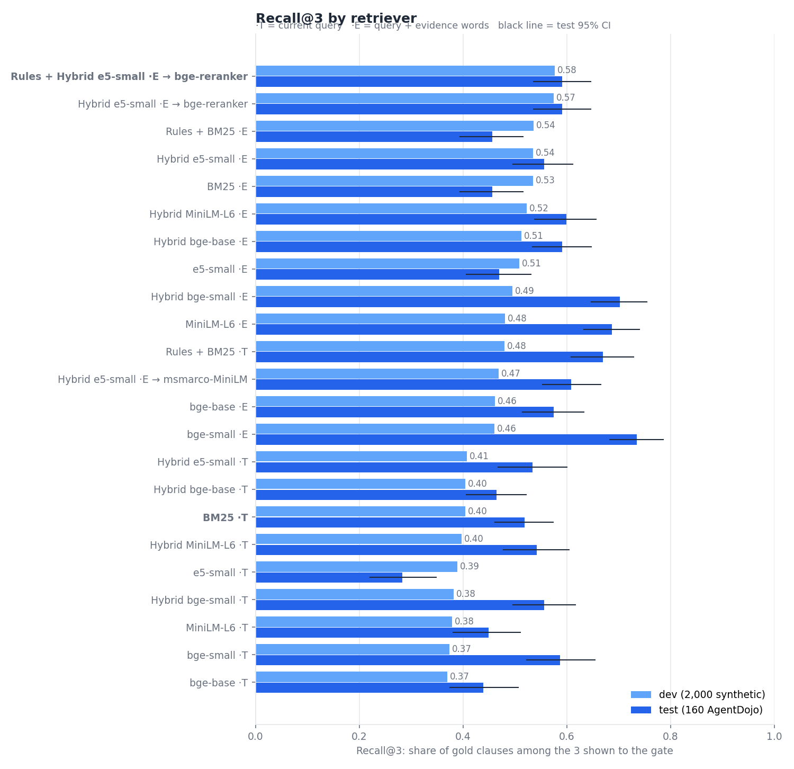
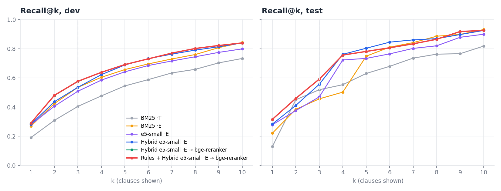
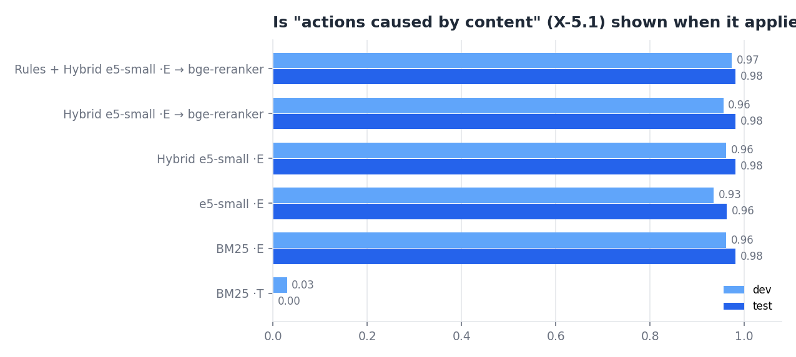
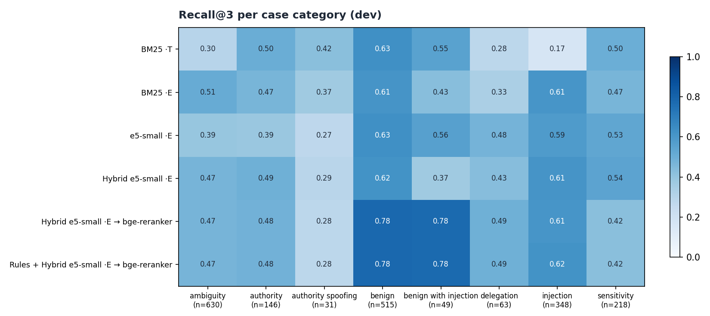
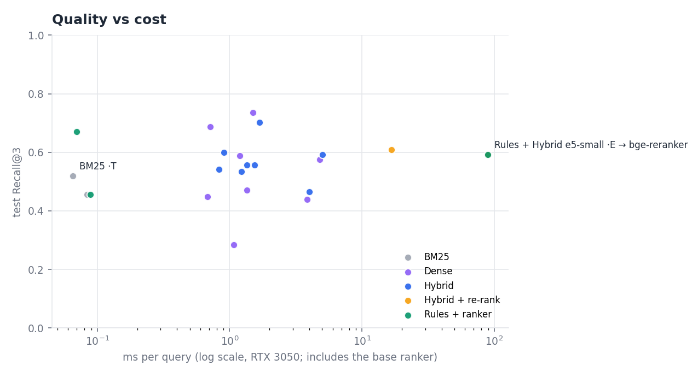

# Policy retrieval experiment

**Best on dev: `Rules + Hybrid BM25+e5-small [evidence] + rerank bge-reranker`**: Recall@3 **0.404 → 0.577** on dev and **0.519 → 0.592** on the held-out test set (95% CI 0.54–0.65), compared with the current BM25 retriever.

## Findings

1. **The biggest problem is the query, not the model.** Today's query leaves out provenance, so on cases where the "actions caused by content" clause (X-5.1) is gold it is shown only 3% (dev) / 0% (test) of the time. Adding a few words for the evidence the gate already has raises that to 96% / 98%, with any retriever.
2. **Best on dev: `Rules + Hybrid BM25+e5-small [evidence] + rerank bge-reranker`.** Recall@3 0.40 → 0.58 (dev), 0.52 → 0.59 (test); Recall@5 0.69 / 0.78. Cost about 89 ms per query on the RTX 3050, which is small next to one gate LLM call, and retrieval is precomputed per case anyway.
3. **Cheap alternative:** `Hybrid BM25+e5-small [evidence]` (no re-ranker): 0.54 / 0.56 at 1.5 ms.
4. **Dev and test do not always agree** (e.g. `bge-small [evidence]` is weak on dev but strongest on test). The test set is small (160 cases, CI about ±0.06) and narrower than the 2,000 dev cases, so the choice is made on dev only and the test set is just a check. The chosen method beats today's on both.
5. **Evidence rules:** only the 5.1 rule is precise (0.92); 6.2 (0.50) and 6.3 (0.25) would push wrong clauses in, so they are not used. With the evidence query the 5.1 rule adds almost nothing.
6. **Three slots are tight.** Cases have 1.74 gold clauses on average; Recall@5 is 0.1–0.2 higher than Recall@3. Showing 5 clauses costs about 120 extra prompt tokens.
7. **Still weak:** authority-spoofing cases (the "claims of approval inside content" clause is rarely found) and ambiguity cases. No evidence field says "content claims an approval" today, so the query cannot ask for it.

**Use in the gate:** the `[evidence]` query uses provenance, so the *no-provenance* ablation must keep the `[trusted]` query (otherwise provenance leaks in through the clauses). After switching, re-retrieve the clauses of every case (training and test) and retrain, so the model is trained on what it will see.

## Setup

- Run: `python experiments/rag/run_rag_exp.py` then `python experiments/rag/make_report.py` (models: all-MiniLM-L6-v2, e5-small-v2, bge-small/base-en-v1.5, ms-marco-MiniLM-L-6-v2, bge-reranker-base).
- Data: dev = 2,000 synthetic cases (method chosen here), test = 160 frozen AgentDojo test cases (only confirmed).
- The current retriever is reproduced exactly: our BM25 gives the same top 3 as stored in the cases on 100.0% of cases.
- Queries use only what the gate already sees, never gold labels. `[trusted]` = today's query (prompt, tool, action, authority, sensitivity); `[evidence]` = the same plus a few words for evidence facts the gate already has (untrusted origin, arguments copied from content, earlier clarification rounds).

## All methods

| Method | dev R@3 | dev R@5 | dev All@3 | test R@3 [95% CI] | test R@5 | test MRR | test X-5.1@3 | ms/query |
|---|---|---|---|---|---|---|---|---|
| Rules + Hybrid BM25+e5-small [evidence] + rerank bge-reranker **(best)** | 0.577 | 0.691 | 0.363 | 0.592 [0.54–0.65] | 0.781 | 0.706 | 0.98 | 89.09 |
| Hybrid BM25+e5-small [evidence] + rerank bge-reranker | 0.575 | 0.691 | 0.360 | 0.592 [0.54–0.65] | 0.781 | 0.706 | 0.98 | 89.09 |
| Rules + BM25 [evidence] | 0.536 | 0.657 | 0.318 | 0.456 [0.39–0.52] | 0.749 | 0.595 | 0.98 | 0.09 |
| Hybrid BM25+e5-small [evidence] | 0.535 | 0.688 | 0.310 | 0.556 [0.50–0.61] | 0.803 | 0.661 | 0.98 | 1.54 |
| BM25 [evidence] | 0.535 | 0.657 | 0.316 | 0.456 [0.39–0.52] | 0.749 | 0.595 | 0.98 | 0.08 |
| Hybrid BM25+MiniLM-L6 [evidence] | 0.523 | 0.680 | 0.315 | 0.599 [0.54–0.66] | 0.865 | 0.695 | 0.94 | 0.91 |
| Hybrid BM25+bge-base [evidence] | 0.512 | 0.663 | 0.285 | 0.592 [0.53–0.65] | 0.709 | 0.649 | 0.98 | 5.00 |
| e5-small [evidence] | 0.508 | 0.641 | 0.295 | 0.470 [0.41–0.53] | 0.733 | 0.642 | 0.96 | 1.35 |
| Hybrid BM25+bge-small [evidence] | 0.495 | 0.650 | 0.285 | 0.702 [0.65–0.75] | 0.861 | 0.644 | 0.98 | 1.68 |
| MiniLM-L6 [evidence] | 0.481 | 0.655 | 0.295 | 0.688 [0.63–0.74] | 0.793 | 0.695 | 0.63 | 0.71 |
| Rules + BM25 [trusted] | 0.480 | 0.614 | 0.253 | 0.670 [0.61–0.73] | 0.760 | 0.675 | 0.98 | 0.07 |
| Hybrid BM25+e5-small [evidence] + rerank msmarco-MiniLM | 0.469 | 0.617 | 0.275 | 0.608 [0.55–0.67] | 0.717 | 0.581 | 0.30 | 16.69 |
| bge-base [evidence] | 0.461 | 0.580 | 0.259 | 0.575 [0.51–0.63] | 0.655 | 0.688 | 0.81 | 4.82 |
| bge-small [evidence] | 0.460 | 0.572 | 0.274 | 0.735 [0.68–0.79] | 0.838 | 0.752 | 0.72 | 1.50 |
| Hybrid BM25+e5-small [trusted] | 0.407 | 0.546 | 0.229 | 0.534 [0.47–0.60] | 0.658 | 0.494 | 0.00 | 1.22 |
| Hybrid BM25+bge-base [trusted] | 0.405 | 0.555 | 0.228 | 0.465 [0.41–0.52] | 0.720 | 0.490 | 0.00 | 4.00 |
| BM25 [trusted] | 0.404 | 0.545 | 0.230 | 0.519 [0.46–0.57] | 0.630 | 0.517 | 0.00 | 0.07 |
| Hybrid BM25+MiniLM-L6 [trusted] | 0.397 | 0.568 | 0.232 | 0.542 [0.48–0.60] | 0.694 | 0.571 | 0.00 | 0.83 |
| e5-small [trusted] | 0.389 | 0.496 | 0.226 | 0.283 [0.22–0.35] | 0.553 | 0.424 | 0.00 | 1.07 |
| Hybrid BM25+bge-small [trusted] | 0.382 | 0.526 | 0.214 | 0.556 [0.50–0.62] | 0.686 | 0.601 | 0.00 | 1.35 |
| MiniLM-L6 [trusted] | 0.379 | 0.547 | 0.228 | 0.449 [0.38–0.51] | 0.644 | 0.540 | 0.07 | 0.68 |
| bge-small [trusted] | 0.374 | 0.454 | 0.224 | 0.588 [0.52–0.65] | 0.660 | 0.547 | 0.00 | 1.20 |
| bge-base [trusted] | 0.369 | 0.478 | 0.226 | 0.440 [0.38–0.51] | 0.518 | 0.514 | 0.02 | 3.85 |

R@k = share of a case's gold clauses among the top k, averaged over cases. All@3 = every gold clause in the top 3. X-5.1@3 = on cases whose gold includes the "actions caused by content" clause, how often it is shown.

## Evidence rules (dev precision)

| Rule (evidence fact → clause) | fired | clause was gold | precision |
|---|---|---|---|
| 5.1 | 356 | 328 | 0.92 |
| 6.2 | 650 | 323 | 0.50 |
| 6.3 | 446 | 113 | 0.25 |

5.1 = untrusted origin of the call or an argument; 6.3 = there was an earlier clarification/approval round; 6.2 = the user cannot authorize and a higher role is required.
